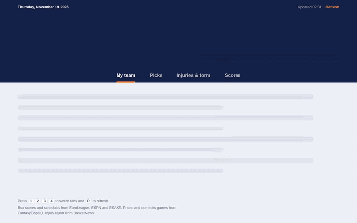
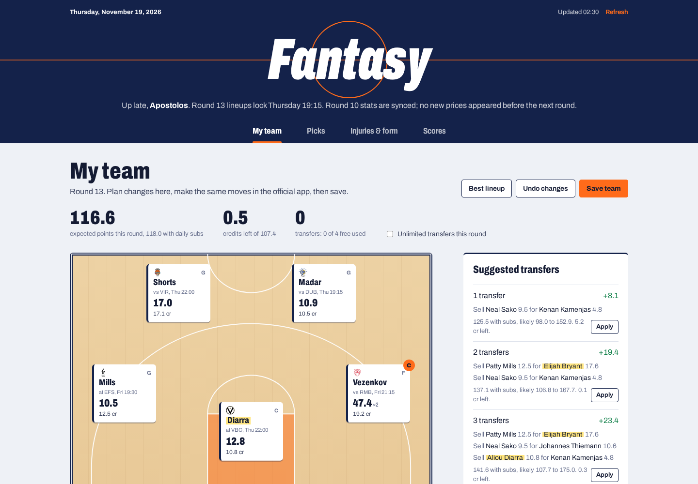
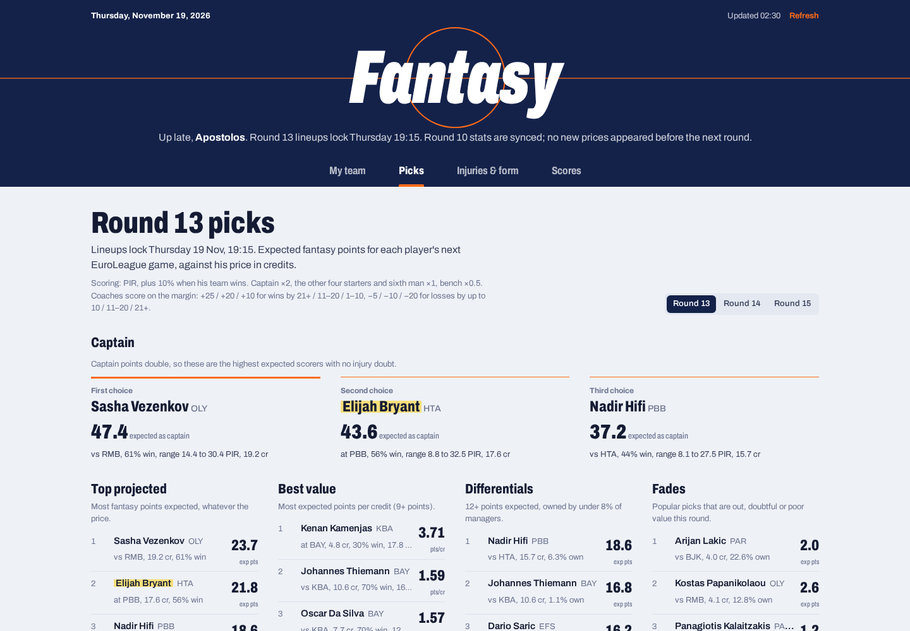
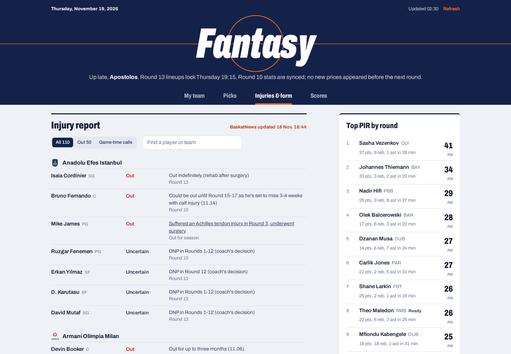
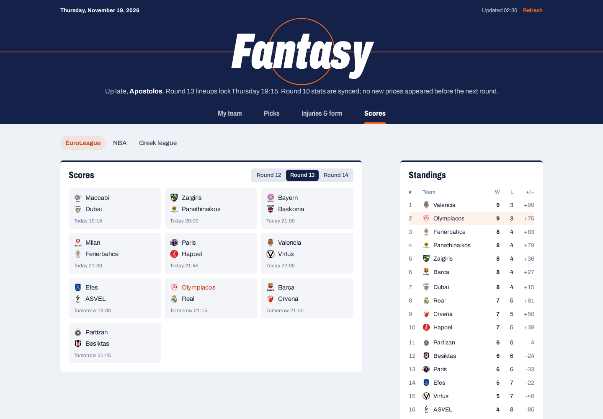
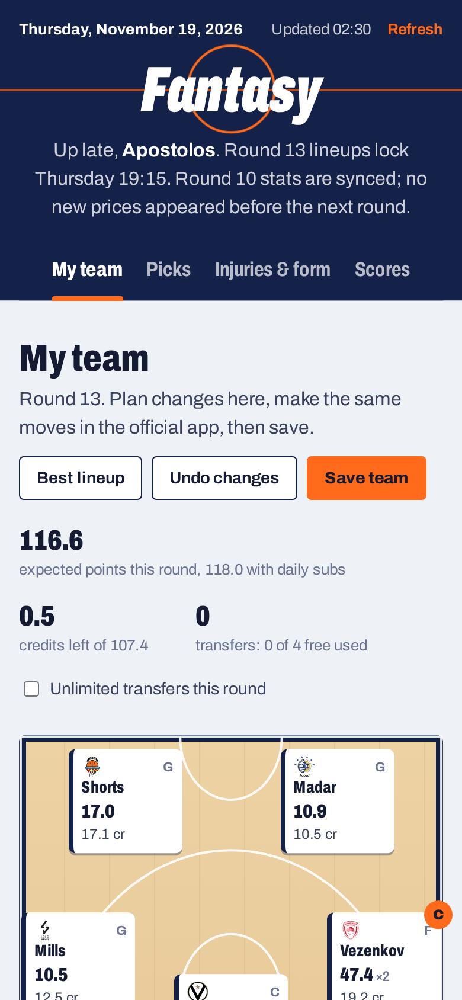

# EuroLeague Fantasy assistant

A self-hosted helper for the **EuroLeague Fantasy Challenge**. It projects every player's
fantasy points, builds the mathematically best team for your budget and transfer limit,
runs your lineup through thousands of simulated rounds, and follows the round live with
the official scoring rules. Basketball scores and standings (EuroLeague, NBA, Greek league)
come with it.

It runs on your own machine (`http://localhost:8420`) with a plain Python server and a
vanilla JavaScript front end. No accounts, no build step, no database.



> Unofficial fan project. Not affiliated with or endorsed by Euroleague Basketball.
> You make your moves in the official app yourself; this tool never logs in anywhere.

## Contents

- [Features](#features)
- [Screenshots](#screenshots)
- [Getting started](#getting-started)
- [How the numbers are made](#how-the-numbers-are-made)
- [Does the model work?](#does-the-model-work)
- [Data sources](#data-sources)
- [Project layout](#project-layout)

## Features

**My team**

- **Live round.** Your lineup on a basketball court with real points for finished games
  (PIR, +10% if the team wins, then the slot multiplier), live scores, and expected points
  for games still to come.
- **Morning subs** that follow the official rules, including a captain change between
  gamedays (even after the captain has played, to a starter who hasn't), and the morning by
  which to make each one.
- **Undo to the last tip-off.** Until the next game starts you can bring back a player who
  already played or a captain you replaced. "Undo changes" restores the lineup as it was at
  the last tip-off.
- **Transfer planner.** Click a player to make him captain, swap him or sell him. The
  suggestions are the exact best team for 1 to 4 transfers, or a full rebuild in unlimited
  rounds. Each one is checked by simulating the round 4,000 times with daily subs.

**Picks**

- Top three captains, top projected, best value per credit, low-ownership differentials and
  popular players to fade.
- **Often tipped:** players that fantasy tip columns keep recommending (Eurohoops' weekly
  column and the FantasyEdgeIQ round preview, last four weeks) get a yellow highlight
  everywhere on the site. Open a player to see which articles tipped him.
- Best team from scratch for any budget.
- A sortable table of every player, with the reasons behind his projection.
- A backtest of the model on past rounds and a live track record of projections saved
  before each lock.

**Injuries & form:** the BasketNews injury report, top PIR by round and season leaders.

**Scores:** EuroLeague, NBA and Greek league results, fixtures and standings.

## Screenshots

| My team | Picks |
| --- | --- |
|  |  |
| **Injuries & form** | **Scores** |
|  |  |

<p align="center"></p>

## Getting started

### Requirements

- Python 3.11 or newer
- numpy and scipy 1.9+ (scipy's `milp` solves the team optimisation)
- Linux (the `bin/fantasy` launcher uses bash and `setsid`). Elsewhere, run `python3 server.py`
  from the project folder.

### Install and run

```sh
git clone https://github.com/apkarpet/euroleague-fantasy.git
cd euroleague-fantasy
python3 -m pip install -r requirements.txt

# put the launcher on your PATH
ln -s "$PWD/bin/fantasy" ~/.local/bin/fantasy

fantasy          # starts the server if needed and opens http://localhost:8420
```

On first start it downloads the season's box scores, prices and schedule, so the first load
is slower. After that everything is cached.

| Command | What it does |
| --- | --- |
| `fantasy` | start the server in the background (if needed) and open the site |
| `fantasy stop` / `restart` / `status` | manage the server (`restart` after editing Python code) |
| `fantasy logs` | follow the server log |
| `fantasy fg` | run in the foreground |
| `fantasy sync` | sync finished rounds' stats and prices now |

Keyboard: `1` to `4` switch tabs, `R` refreshes.

### Settings

`config.json`:

| Key | Meaning |
| --- | --- |
| `name` | name used in the greeting |
| `port` | server port (default 8420) |
| `favorite_teams` | teams highlighted in scores and standings |
| `injury_report_url` | the BasketNews injury report article |

### Automatic sync after each round (optional)

`systemd/` holds a user timer that syncs on Thursday and Saturday mornings, hourly from
07:00 to 11:00, whether or not the server is running:

```sh
cp systemd/fantasy-sync.* ~/.config/systemd/user/
systemctl --user daemon-reload
systemctl --user enable --now fantasy-sync.timer
```

The first run after a round fetches its box scores again to pick up late stat corrections.
Each run also checks for new prices, and projections are rebuilt when either changes.

### Where things are kept

| Path | Contents |
| --- | --- |
| `~/.local/share/fantasy/my-team.json` | your team (plan in the site, make the same moves in the official app, then press Save) |
| `~/.local/share/fantasy/tracking/` | projections saved before each round locks |
| `~/.local/share/fantasy/prices.jsonl` | one price snapshot per day |
| `~/.local/share/fantasy/round-sync.json` | how far the round sync got |
| `~/.cache/fantasy/` | downloaded data and the server log |

## How the numbers are made

### Scoring

The official game scores a player's **PIR**, plus 10% when his team wins. In a lineup the
captain counts ×2, the other four starters and the sixth man ×1, and the four bench players
×0.5. Coaches score on the final margin: a win by 21+ is +25, by 11–20 +20, by 1–10 +10; a
loss by up to 10 is −5, by 11–20 −10, by 21+ −20.

### Projections (`newsdesk/picks.py`)

```
projected PIR = minutes × PIR per minute × matchup × home/away × availability
```

- **Minutes:** recency-weighted EuroLeague minutes, nudged by recent domestic-league
  minutes, plus minutes inherited from teammates who just went out injured.
- **PIR per minute:** last season's rate as a prior, updated with this season's EuroLeague
  games (recent games count extra) and domestic games (count less).
- **Matchup:** how much PIR the opponent allows to the player's position, shrunk towards the
  league average while samples are small.
- **Home/away:** the league-wide home edge, measured from this season's games.
- **Availability:** status from the injury report.

Expected fantasy points add the 10% win bonus times the team's win chance. Expected coach
points treat the final margin as normally distributed around the predicted spread (σ = 11).

### Team building (`newsdesk/optimize.py`)

1. **Exact optimisation.** A mixed-integer program (scipy + HiGHS) picks the roster *and*
   its lineup together, maximising expected lineup points under the budget, the 4 G / 4 F /
   2 C roster rule and the transfer limit. It returns the best few teams, not just one.
2. **Monte Carlo round simulation.** Each candidate team plays the round 4,000 times with
   random scores and availability, and the simulator makes morning subs day by day the way
   a manager would. This values things a single projection can't, like a bench player whose
   game comes after the starters' (insurance) or a doubtful starter whose news arrives the
   morning of his game.

## Does the model work?

Every model change is tested by replaying finished rounds using only what was known before
tip-off. Settings were tuned on rounds 4–7 and checked on rounds 8–9. Ideas that didn't beat
noise (team ratings, pace, a usage boost for injured players' teammates, missing opposing
defenders, a price prior, a multi-round horizon) are left switched off, and the code says so.

Replay of rounds 4–12 of the 2026-27 season:

| Predicting each player's points with | Mean abs. error (PIR) | Correlation | Avg. captain points |
| --- | --- | --- | --- |
| **This model** | **5.69** | **0.376** | **25.5** |
| Season average | 5.92 | 0.361 | 21.6 |
| Last 3 games | 6.23 | 0.326 | 17.4 |

Teams built by the optimiser from a 95-credit budget with 4 transfers a round averaged
**125.2 points per round**, against 102.9 for the same optimiser fed season averages
(**+22%**). The best possible team in hindsight averaged 262.6, which shows how much of a
single round is luck.

The Picks tab shows these tables live, updated after every round.

## Data sources

| Data | Source |
| --- | --- |
| Box scores, schedule, standings, PIR | Official EuroLeague public feeds |
| Fantasy prices, ownership, domestic box scores | FantasyEdgeIQ public CSV and pages |
| Injury report | BasketNews "EuroLeague Injury Report (updated daily)" |
| Fantasy tips | Eurohoops fantasy column (WordPress API), FantasyEdgeIQ round preview |
| NBA and Greek league scores | ESPN public API, esake.gr |

Everything comes from public pages and is cached on disk, so each source is asked for
little. Tips are display-only and don't change the projections.

## Project layout

```
bin/fantasy            launcher (start/stop/logs/sync)
server.py              HTTP server and JSON API (standard library only)
newsdesk/
  picks.py             projections, backtests, pick lists
  optimize.py          MILP team optimiser, Monte Carlo round simulator, team backtest
  fantasy.py           EuroLeague player data and name matching
  roundsync.py         post-round sync of stats and prices
  tips.py              tip-column scraping and scoring
  sports.py            EuroLeague / NBA / Greek league scores and standings
  cache.py, net.py     disk cache and HTTP helpers
static/                index.html, app.js, team.js (court and live round), style.css
systemd/               optional sync timer
```

## Built with

Python standard library (`http.server`, `urllib`, `zoneinfo`), numpy, scipy (HiGHS MILP),
and vanilla HTML, CSS and JavaScript.
